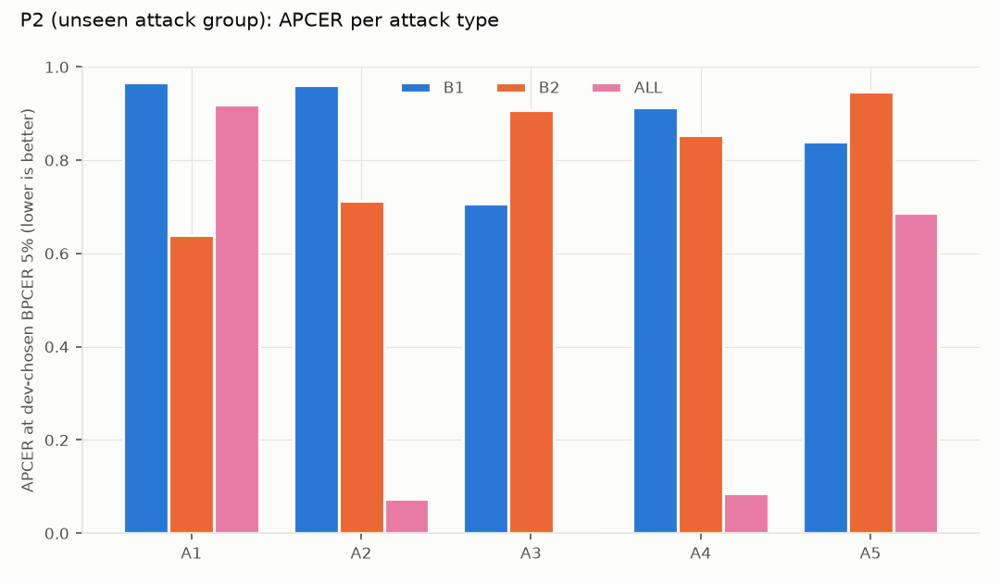
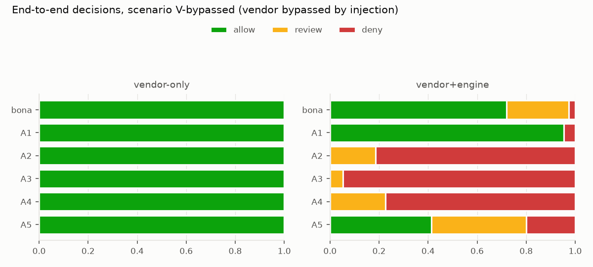

# Evaluation summary: multi-layer deepfake / spoof / injection detection on top of a liveness vendor

*CPU-only prototype; all numbers below come from one full run of this repository (2026-10-14).
Running `fdemo bench` and `fdemo recommend` regenerates the full tables (`reports/benchmark_report.md`) and the
operating rules (`reports/recommendations.md`) locally.*

---

## 1. Data used for evaluation

Two kinds of data are used. **Real people** come from a public dataset. **Attacks** are synthesised by us, and one
public set of third-party fakes serves as an independent check.

### 1.1 Bona fide (real people): RAVDESS, public

| Property | Value |
|---|---|
| Source | RAVDESS (Ryerson Audio-Visual Database of Emotional Speech and Song), Zenodo record 1188976, CC BY-NC-SA 4.0 |
| What it is | Professional actors recorded in a studio, frontal face, white background, 1280×720 @ 29.97 fps |
| Subset used | 12 actors (6 male, 6 female) × 15 "video-only speech" clips = **180 clips** |
| Preparation | Trimmed to 3.2 s, resampled to 25 fps, 640×360, 80 frames |
| Identity split | 4 folds × 3 actors (each fold has both sexes); every evaluation is **identity-disjoint** |

Caveat: these are real people in front of a real camera, but in a studio and already H.264-compressed. They are
not phone or webcam KYC captures.

### 1.2 Attacks synthesised by us: 750 videos, 5 types × 150

Each attack is generated from the real clips above. For face swaps, the target identity is a held-out-fold actor
and the source identity is another actor **from the same fold**, so no training identity leaks into testing.
Real and attack videos go through **exactly the same decode → re-encode → "SDK capture" path** (640×360, 25 fps,
80 frames, H.264 CRF 23). The only difference between a real and a fake video is therefore the attack itself, not
the codec, resolution or an extra compression step.

| ID | Attack | How it is generated | Real-world counterpart | Standard |
|---|---|---|---|---|
| A1 | Classic face swap | 84 MediaPipe landmarks, Delaunay warp on the target, LAB colour transfer, Poisson (`seamlessClone`) or feathered alpha blending | Older swap tools / manual editing | Digital deepfake |
| A2 | Neural face swap | **inswapper_128** (InsightFace): ArcFace identity embedding of the source, 128×128 swap of the aligned target face, soft paste-back | **Deep-Live-Cam / roop / FaceFusion**, the tools used against KYC today | Digital deepfake |
| A3 | Screen replay (simulated) | Down/up-sampling, gamma/white-balance shift, moiré grating, glare, perspective warp, new sensor noise | Phone or monitor held in front of the camera | ≈ iBeta L1 PAI |
| A4 | Virtual-camera injection | A2 stream emulated at 15 fps and duplicated to 25 fps (real-time preserved), denoise or temporal blending (OBS-like filters), lossy re-encode | Real-time deepfake piped through OBS Virtual Camera / v4l2loopback | CEN/TS 18099 IAI |
| A5 | Printed photo (simulated) | One frame desaturated, lower contrast, paper texture, smooth hand-held affine jitter, sensor noise | Photo printout held to the camera | ≈ iBeta L1 PAI |

### 1.3 Independent fakes: TalkingHeadBench, public

| Property | Value |
|---|---|
| Source | Hugging Face `luchaoqi/TalkingHeadBench` (fake videos only; real videos are not distributed) |
| Subset used | `test` split, 20 videos from each of 6 generators = **120 fakes**: AniPortrait-Audio, AniPortrait-Video, EmoPortrait, Hallo, Hallo2, LivePortrait (reenactment) |
| Why | Generators **we did not build**, at higher visual fidelity than our synthetic attacks; this is the independent generalisation test (P3) |
| Preparation | Square videos centred on a blurred 16:9 background, then the same SDK capture (the padding is disclosed and checked in §5.4) |

**Totals:** 180 real + 750 synthetic attacks + 120 external fakes = **1,050 videos**.

---

## 2. Open-source baselines

Both baselines are used **as published**, with their reference preprocessing (crop scales, normalisation, class
index), so they are not handicapped.

| ID | Model | Type | What it detects | Preprocessing kept |
|---|---|---|---|---|
| **B1** | **MiniFASNet** V2 + V1SE (Silent-Face-Anti-Spoofing, Apache-2.0) | Passive liveness / presentation-attack detection, the most widely used open-source PAD model | Print and screen artefacts on a single frame | Crops at scale 2.7 and 4.0, 80×80, raw BGR; p(real) averaged over both models and 16 frames; score = 1 − p(real) |
| **B2** | **SBI**, Self-Blended Images (CVPR 2022), EfficientNet-B4, FF++ c23 weights (research licence) | Deepfake detector | Face-swap blending boundaries | Official test-time crop (w/8, h/8 margin), 380×380 RGB; mean fake-probability over 16 frames |

One deviation applies to both: faces are located with RetinaFace-MobileNet (uniface) instead of RetinaFace-ResNet50,
for CPU speed.

In the end-to-end simulation B1 also plays the role of the liveness vendor ("stand-in"). **It is not FaceTec.**

---

## 3. Our method

### 3.1 Forensic signal layer (5 groups, 21 features, ~1.2 s per video on CPU)

| Group | What is measured | Target |
|---|---|---|
| **blend_noise** | Noise-residual statistics (image minus 3×3 median) in the face core, a ±8 px ring around the face hull, and the background just outside it: std ratios, kurtosis difference, edge gradient; frames with flat regions are skipped | Pasted / blended faces |
| **spectrum** | Azimuthal log-power spectrum of the face crop: high/low-frequency ratio, spectral slope, outlier peaks | Up-sampling blur (swaps), re-capture and moiré (replay) |
| **temporal** | Over all 80 frames: duplicated-frame rate, inter-frame variability, **correlation of sensor-noise residuals between consecutive frames** on the background, landmark jitter | Virtual-camera pipelines (frame duplication, denoising, blending), static prints |
| **identity** | ArcFace embedding drift across 16 frames | Identity flicker in swaps |
| **rPPG** | POS remote photoplethysmography on forehead and cheeks: pulse SNR, cheek agreement | Faces without a physiological pulse |

The two baselines' scores (with simple temporal aggregation: top-k, std) are also available as features.

### 3.2 Fusion (risk engine)

- **F** = our 21 forensic features only. **ALL** = forensic + baseline features (28).
- Per training split, the model family is chosen by cross-validated AUC: logistic regression (L2) or
  HistGradientBoosting (depth 3). Cross-validation is grouped by identity fold. Classes are balanced, and missing
  values get median imputation plus missing-flags.
- Output: a **risk score in [0, 1]**.

### 3.3 Decision layer (what makes it deployable)

- Two thresholds, both chosen on **development data only**:
  - τ_deny: at most 1% of genuine users auto-denied.
  - τ_review: at most 5% of attacks auto-allowed.
- **Routing**, evaluated in this order:
  1. vendor liveness not proven → deny
  2. invalid thresholds → review
  3. no face → review
  4. signal failure → review
  5. risk ≥ τ_deny → deny
  6. risk ≥ τ_review → review
  7. weak Photo-ID match (< level 6) → review
  8. otherwise allow
- The engine **fails closed**: no error path ever auto-allows.
- **FaceTec-aware vendor adapter:**
  - Reads v10 `result.livenessProven` across the whole session, since it only appears in the liveness step.
  - Reads `matchLevel` / `matchLevelNFCToFaceMap`.
  - Checks `externalDatabaseRefID` for consistency, with an optional expected reference.
  - A failed liveness step overrides an earlier success.

---

## 4. Metrics (ISO/IEC 30107-3)

The risk score is compared with a threshold τ: **score ≥ τ → classified as attack**.

| Metric | Definition | Meaning |
|---|---|---|
| **APCER** | Share of **attacks classified as bona fide** (score < τ) | **Security risk**: attacks that get through |
| **BPCER** | Share of **bona fide classified as attacks** (score ≥ τ) | **User cost**: genuine users rejected or sent to review |
| APCER_max | APCER of the worst attack type | ISO headline: an attacker picks the weakest spot |
| APCER @ BPCER = 1% | Attacks let through when only 1% of genuine users are flagged | Security at good UX |
| BPCER @ APCER = 5% | Genuine users flagged when only 5% of attacks get through | UX cost at good security |
| AUC | Separation over all thresholds (1.0 perfect, 0.5 chance) | Threshold-free summary |
| ACER | (APCER_max + BPCER) / 2 | ISO 2017; deprecated in 2023, shown for reference only |

APCER and BPCER trade off against each other, so **systems are only compared at a fixed BPCER (or APCER)**.

**Protocols** (all identity-disjoint, 4 folds):

- **P1, seen attacks:** all attack types appear in training.
- **P2, unseen attacks:** one attack group is held out of training. The groups are G1 = A1, G2 = A2 + A4 together
  (A4 is derived from A2), G3 = A3 and G4 = A5. **This is the main test.**
- **P3, external generators:** trained on our synthetic data, tested on the 120 TalkingHeadBench fakes; each video
  is scored by the 4 fold models and counted by majority vote.

**Operating point for the per-attack tables:** τ_op is set on development data at BPCER = 5%.

**Confidence intervals:** exact Clopper–Pearson, plus an actor-cluster bootstrap (2,000 resamples). The bootstrap
is enveloped with Clopper–Pearson, so it is never narrower than the exact interval.

---

## 5. Results: our method vs. baselines

### 5.1 Threshold-free summary

| | AUC P1 | AUC P2 | APCER @ BPCER 1%, P1 | APCER @ BPCER 1%, P2 | BPCER @ APCER 5%, P1 |
|---|---|---|---|---|---|
| B1 MiniFASNet | 0.626 | 0.649 | 91.2% | 89.6% | 95.0% |
| B2 SBI | 0.638 | 0.625 | 88.3% | 88.7% | 93.9% |
| B2+ SBI + temporal aggregation | 0.637 | 0.595 | 87.5% | 88.5% | 93.9% |
| **F, our forensic signals** | **0.955** | **0.859** | 18.8% | **40.5%** | 33.3% |
| **ALL, fusion of everything** | 0.954 | **0.859** | **18.1%** | 43.4% | **32.8%** |

### 5.2 APCER per attack type at τ_op (BPCER ≈ 5%; lower is better)

| Attack | B1 | B2 | F, P1 | F, P2 (unseen) | ALL, P1 | ALL, P2 (unseen) |
|---|---|---|---|---|---|---|
| A1 classic swap | 97% | **64%** | 66% | 85% | **64%** | 92% |
| A2 neural swap (inswapper) | 96% | 71% | **1%** | **1%** | 2% | 7% |
| A3 screen replay | 71% | 91% | **0%** | 1% | **0%** | **0%** |
| A4 virtual-camera injection | 91% | 85% | **1%** | 12% | **1%** | **9%** |
| A5 printed photo | 84% | 95% | 30% | **67%** | **23%** | 69% |
| BPCER measured | 7.2% | 5.0% | 3.9% | 4.0% | 7.2% | 5.6% |

Risk engine (ALL) on P2 with 95% actor-bootstrap intervals:

| Attack | APCER | 95% CI |
|---|---|---|
| A1 | 92.0% | 86.4–96.6% |
| A2 | 7.3% | 0.0–15.4% |
| A3 | 0.0% | 0.0–2.4% |
| A4 | 8.7% | 3.1–16.6% |
| A5 | 68.7% | 50.7–84.4% |

### 5.3 End-to-end: what the whole system does when the liveness vendor is bypassed

This is the scenario the client fears: the vendor returns "live" for every session, as if an injection got past it.

| Attack | Vendor only: allow | Vendor + our engine: allow / review / deny |
|---|---|---|
| A2 neural swap | 100% | **0%** / 19% / 81% |
| A4 injection | 100% | **0%** / 23% / 77% |
| A3 replay | 100% | **0%** / 5% / 95% |
| A5 print | 100% | 41% / 39% / 20% |
| A1 classic swap | 100% | 95% / 0% / 5% |
| **Genuine users** | 100% | **72%** / 25% / 2.6% |

### 5.4 External generators (P3, TalkingHeadBench), APCER (lower is better)

| Generator | B1 | B2 | ALL | ALL without temporal group |
|---|---|---|---|---|
| AniPortrait-Audio | 75% | 80% | 80% | 90% |
| AniPortrait-Video | 85% | 70% | 90% | 80% |
| EmoPortrait | 80% | **50%** | 55% | 55% |
| Hallo | 80% | 95% | **70%** | 80% |
| Hallo2 | 90% | 90% | **75%** | 75% |
| LivePortrait | 80% | 80% | **70%** | 70% |
| **Overall** | 82% | 78% | 73% (F: **69%**) | — |

Removing the temporal group barely changes P3, so the blurred padding is not what drives detection.

### 5.5 Which signals matter (P2 ablation, ALL without one group)

| Removed group | APCER @ BPCER 1% | Δ |
|---|---|---|
| none | 43.4% | — |
| spectrum | 90.5% | **+47.1 pp** |
| temporal | 44.4% | +0.9 pp |
| blend_noise | 43.7% | +0.3 pp |
| identity / rPPG / SBI / MiniFASNet | 41.5–43.4% | ≤ 0 pp |

**Latency (CPU, mean per 80-frame video):**

| Component | Time |
|---|---|
| Our 5 signal groups (total) | ~1.2 s |
| SBI | 4.5 s |
| MiniFASNet | 1.4 s |
| Whole pipeline | ~8 s |

---

## 6. Discussion: why it works, and where it does not

**Large gains on the attack vectors that matter most for remote KYC.**

- For neural face swap, virtual-camera injection and screen replay, APCER drops from **71–96% (best baseline) to
  0–12%** at a comparable BPCER.
- This holds even when that attack type was never seen in training (P2).
- When the vendor is bypassed, the engine stops or escalates **100%** of these sessions.

**Why our signals work:**

- The baselines each look at one kind of evidence in single frames:
  - MiniFASNet looks for print/screen texture.
  - SBI looks for blending seams from the FaceForensics++ manipulations it was trained on.
- Modern attacks leave different traces:
  - **Spectrum:** neural swappers render the face at low resolution and up-sample it, and replays re-sample the
    whole image. Both remove high-frequency energy, which the spectral slope captures. This is the strongest
    signal (+47 pp in the ablation).
  - **Temporal:** virtual-camera pipelines duplicate frames and denoise or blend them over time. Real sensor
    noise is independent from frame to frame; processed streams are not. Real data shows inter-frame noise
    correlation 0.81 (A4) and 0.87 (A5) vs 0.64 for real people, and duplicate-frame rate 0.32 (A4) vs 0.17.
  - These are properties of the **video stream**, which a per-frame classifier cannot see.
- Being cheap (~1.2 s per video), the forensic layer can run on every session.

**Adding the open-source models to the fusion does not help.**

- F (ours only) ≈ ALL, and F is slightly better on P2 and P3.
- Temporal aggregation of SBI (B2+) gives no gain either.

**Weaknesses:**

- **Unseen classic face swaps (A1): 85–92% get through**, worse than SBI alone (64%). When A1 is held out of
  training, the fusion learns from A2/A4, where SBI is weak, and so discards the one signal A1 needs.
- **Unseen printed photos (A5): 67–69%** get through.
- **High-fidelity talking-head fakes (P3): 69–73%** get through, only 5–13 points better than the baselines.
  Fully-generated faces have no blending seam and no low-resolution face patch.
- **ISO view:** APCER_max (the worst attack type) barely improves, so ACER only moves from 49.8% (B2) to 48.8%.
  The gains are per attack type, not uniform.
- **User cost:** at the chosen thresholds, about **25% of genuine users** are routed to manual review.

---

## 7. Limitations, and how we would improve this together

### Current limitations

| Limitation | Effect |
|---|---|
| Attacks are synthesised by us at "commodity" level. A2 inherits inswapper's 128 px face and a visible square paste-back edge; A3/A5 are digital simulations, not real re-captures | Results on A2/A3/A4 are **optimistic**; P3 is closer to the true difficulty of high-quality fakes |
| Bona fide are studio recordings (RAVDESS), not phone/webcam KYC sessions | Thresholds and noise-based signals must be re-fit on real traffic |
| No real virtual-camera, emulator or hardware-injection test; no device or app integrity signal (specified, not built) | Injection coverage is content-based only |
| The vendor is a stand-in (MiniFASNet), not FaceTec; FaceTec v9 liveness fields are not parsed | End-to-end numbers show the integration logic, not FaceTec's real behaviour |
| 12 identities, 150 attacks per type | Wide confidence intervals (e.g. A5: 51–84%) |
| SBI weights, inswapper and RAVDESS are research / non-commercial assets | Demo only, not production |

### Improvement plan when working on your system

1. **Review your real FaceTec flow** (platforms, SDK/Server version, server-side verification, session binding,
   fallbacks, match levels). Most real compromises happen around the SDK, not inside it.
2. **Red-team on your staging environment with real tools:**
   - Deep-Live-Cam through OBS / v4l2loopback;
   - emulator and Frida camera hooking;
   - HDMI capture adapters;
   - real screen and print re-captures;
   - AI-generated ID photos.

   Report APCER per attack type with intervals, exactly as here.
3. **Re-fit the engine on your labelled sessions:**
   - recalibrate τ_review / τ_deny to your fraud and UX targets;
   - reduce the ~25% review load;
   - monitor score drift (PSI).
4. **Close the known gaps:**
   - Use SBI as a **dedicated gate for classic swaps** instead of a fusion feature.
   - Add print/screen-specific cues for A5.
   - Add higher-resolution swappers (256/512 px) and talking-head generators to training, while keeping separate
     generators for testing.
5. **Build the session and device-integrity layer** that is now only specified:
   - Play Integrity / App Attest;
   - virtual-camera and driver detection;
   - capture-timestamp jitter;
   - server-issued nonce bound to `externalDatabaseRefID`.

   This is the most direct defence against injection, complementary to the content signals above.
6. **Deliverables in your context:**
   - a vulnerability assessment of your actual flow;
   - a test report on real attacks;
   - the deployed mitigation with before/after APCER/BPCER;
   - a thresholds / monitoring / manual-review playbook.

   This repository already produces the test report and the thresholds/monitoring playbook
   (`fdemo bench`, `fdemo recommend`); the vulnerability assessment is written for your actual flow.

---

## 8. Conclusion

**What the evidence shows**

- **Open-source liveness and deepfake models alone do not protect a remote identity flow against today's
  attacks.**
  - The most widely used passive liveness model (MiniFASNet) accepted 71–97% of every attack type.
  - The deepfake detector (SBI) accepted 64–95%.
  - At a user-friendly operating point (1% of genuine users flagged), both let through about 90% of attacks.
- **A cheap forensic layer that looks at the video stream changes that for the attacks that matter most in remote
  KYC.** Neural face swaps (Deep-Live-Cam class), virtual-camera injection and screen replay drop to **0–12%
  accepted**, including when the attack type was never seen in training. The layer costs about 1.2 s of CPU per
  session.
- **As a second line of defence, it holds when the liveness vendor itself is bypassed.** In that scenario 100% of
  neural-swap, injection and replay sessions were denied or sent to manual review, against 100% accepted without it.

**What it does not show yet**

- Coverage is uneven:
  - Unseen classic face swaps and printed photos still get through (67–92%).
  - High-fidelity talking-head fakes from independent generators get through 69–73% of the time, only modestly
    better than the baselines.
- The operating cost is real: about a quarter of genuine users would go to manual review at the current
  thresholds.
- The attacks are synthesised at commodity level, the real people are studio recordings, and the vendor is a
  stand-in. The strong numbers are an **upper bound**, not a production guarantee.

**What this means for a FaceTec-based flow**

The prototype supports a layered design rather than a replacement:

1. **FaceTec** remains the liveness and matching core.
2. **Session and device integrity checks** stop injection at the source.
3. **The content-forensics risk engine** catches what gets past the first two.
4. **A threshold-and-review policy** fails closed and is tuned to the client's own fraud and UX targets.

The evaluation method (identity-disjoint folds, unseen-attack protocol, per-attack APCER/BPCER with honest
confidence intervals, end-to-end vendor scenarios) is ready to be applied unchanged to the client's own sessions
and red-team attacks. That is the step that turns these lab results into numbers the client can act on.
